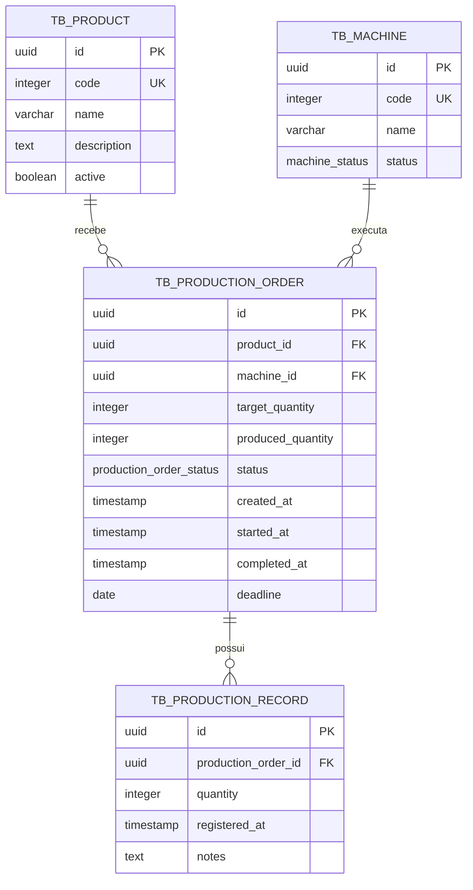

# Modelo de domínio

## Contexto

A API gerencia produtos, máquinas, ordens de produção e apontamentos realizados durante a fabricação.

## Entidades

### Product

Representa um produto que pode ser fabricado e desativado sem ser removido do banco.

| Atributo | Tipo Java | Coluna | Obrigatório | Regra |
|---|---|---|---|---|
| `id` | `UUID` | `id` | sim | Gerado após a conversão da V3 |
| `code` | `Integer` | `code` | sim | Código numérico único gerado pelo banco |
| `name` | `String` | `name` | sim | `NOT NULL`, até 150 caracteres |
| `description` | `String` | `description` | não | Texto opcional |
| `active` | `Boolean` | `active` | sim | Nasce ativo; produtos são desativados, não excluídos |

### Machine

Representa uma máquina que pode receber ordens quando está disponível.

| Atributo | Tipo Java | Coluna | Obrigatório | Regra |
|---|---|---|---|---|
| `id` | `UUID` | `id` | sim | Gerado após a conversão da V3 |
| `code` | `Integer` | `code` | sim | Código numérico único gerado pelo banco |
| `name` | `String` | `name` | sim | `NOT NULL`, até 150 caracteres |
| `status` | `MachineStatus` | `status` | sim | `AVAILABLE`, `MAINTENANCE` ou `INACTIVE`; padrão `AVAILABLE` |

### ProductionOrder

Representa uma ordem para fabricar um produto em uma máquina, com quantidade e ciclo de vida próprios.

| Atributo | Tipo Java | Coluna | Obrigatório | Regra |
|---|---|---|---|---|
| `id` | `UUID` | `id` | sim | Gerado após a conversão da V3 |
| `product` | `Product` | `product_id` | sim | FK para `tb_product(id)` |
| `machine` | `Machine` | `machine_id` | sim | FK para `tb_machine(id)` |
| `targetQuantity` | `Integer` | `target_quantity` | sim | Deve ser positiva no DTO de entrada |
| `producedQuantity` | `Integer` | `produced_quantity` | sim | Nasce com zero e é incrementada pelos apontamentos |
| `status` | `ProductionOrderStatus` | `status` | sim | `PENDING`, `IN_PROGRESS`, `COMPLETED` ou `CANCELLED`; padrão `PENDING` |
| `createdAt` | `LocalDateTime` | `created_at` | sim | Preenchido na criação |
| `startedAt` | `LocalDateTime` | `started_at` | não | Preenchido ao iniciar |
| `completedAt` | `LocalDateTime` | `completed_at` | não | Preenchido ao concluir |
| `deadline` | `LocalDate` | `deadline` | não | Deve ser hoje ou uma data futura |

### ProductionRecord

Representa um apontamento de quantidade produzida para uma ordem em andamento.

| Atributo | Tipo Java | Coluna | Obrigatório | Regra |
|---|---|---|---|---|
| `id` | `UUID` | `id` | sim | Gerado após a conversão da V3 |
| `productionOrder` | `ProductionOrder` | `production_order_id` | sim | FK para `tb_production_order(id)` |
| `quantity` | `Integer` | `quantity` | sim | Deve ser positiva e não pode ultrapassar o planejado |
| `registeredAt` | `LocalDateTime` | `registered_at` | sim | Preenchido no registro |
| `notes` | `String` | `notes` | não | Observações opcionais |

## Relacionamentos

| De | Para | Tipo | No banco | No código |
|---|---|---|---|---|
| `ProductionOrder` | `Product` | muitos para um | `tb_production_order.product_id` referencia `tb_product(id)` | `@ManyToOne` em `ProductionOrder` |
| `ProductionOrder` | `Machine` | muitos para um | `tb_production_order.machine_id` referencia `tb_machine(id)` | `@ManyToOne` em `ProductionOrder` |
| `ProductionRecord` | `ProductionOrder` | muitos para um | `tb_production_record.production_order_id` referencia `tb_production_order(id)` | `@ManyToOne` em `ProductionRecord` |

## Diagrama ER



## Migrations

| Versão | Arquivo | O que cria ou altera |
|---|---|---|
| V1 | `V1__create_production_schema.sql` | Cria os enums, as quatro tabelas, chaves estrangeiras e índices iniciais com IDs inteiros |
| V2 | `V2__seed_demo_data.sql` | Insere produtos, máquinas, ordens e apontamentos de demonstração |
| V3 | `V3__convert_ids_to_uuid.sql` | Converte os IDs e FKs das quatro tabelas para `UUID`, recria chaves e índices |

## Organização do código

O código Java está organizado por camada em `src/main/java/api`:

```text
api/
├── config/
├── controller/
├── service/
├── mapper/
├── repository/
├── model/
└── dto/
```
